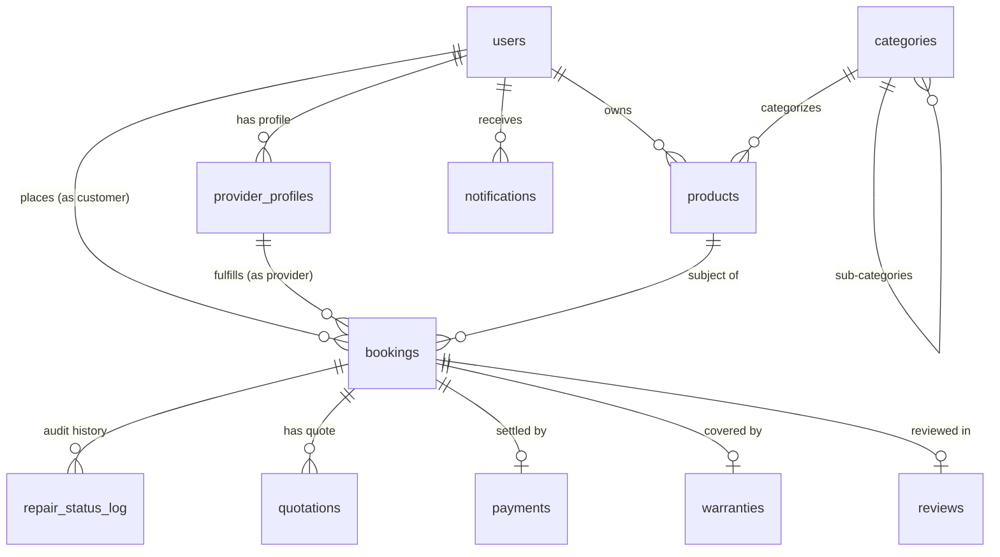
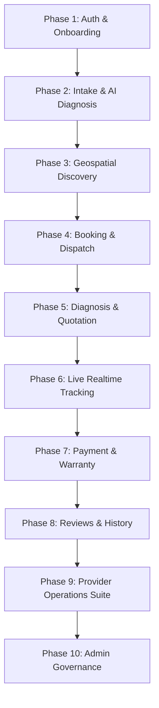

# EcoFix — Complete Implementation Plan & Architecture Specification

> **"Repair. Reuse. Revalue."**
> A unified multi-platform digital marketplace connecting consumers with verified repair businesses and independent technicians.

---

## 1. Executive Summary & Architecture Overview

EcoFix is built around a **Single Backend Architecture** where both the **Next.js 15 Web Application** and the **Android (Kotlin / Jetpack Compose) Application** interface with a unified **Supabase (PostgreSQL)** backend.

```
                               ┌─────────────────────────────────────────┐
                               │       Unified Supabase Backend          │
                               │  - PostgreSQL + PostGIS (Single Source) │
                               │  - Supabase Auth (Shared JWTs)          │
                               │  - Storage (Repair Photos/Videos/Docs)  │
                               │  - Realtime WS (Logical Replication)    │
                               │  - Edge Functions (Payments/FCM/AI)     │
                               └────────────────────┬────────────────────┘
                                                    │
                               ┌────────────────────┴────────────────────┐
                               │                                         │
                 REST / WS / SSR Session                   REST / WS / Offline Room Sync
                               │                                         │
                     ┌─────────▼─────────┐                     ┌─────────▼─────────┐
                     │  Next.js 15 Web   │                     │ Android Compose   │
                     │  (App Router)     │                     │ (Kotlin + Hilt)   │
                     └───────────────────┘                     └───────────────────┘
```

### Core Architecture Principles
1. **Single Database & API Surface**: No per-platform backend services. Both clients execute queries and RPCs directly against Supabase PostgREST.
2. **PostgreSQL as the Authoritative Source of Truth**: Relational constraints, cascading rules, and triggers strictly control state transitions.
3. **Database-Level Row-Level Security (RLS)**: Access control is enforced at the PostgreSQL layer, preventing data leakage regardless of client platform.
4. **Instant Realtime Sync**: Both web and mobile subscribe to PostgreSQL change streams (`repair_status_log` and `bookings`) via WebSockets.
5. **Immutable Audit Trail**: An automatic trigger writes all status transitions into `repair_status_log`. Neither web nor mobile can bypass or rewrite audit records.
6. **Unified Notification Hub**: Status changes trigger Edge Functions which dispatch simultaneous notifications to Web Push and Firebase Cloud Messaging (FCM).

---

## 2. Database & Security Schema

### 2.1 Entity Relationship Diagram (Schema Summary)



---

### 2.2 Table Specifications

```sql
-- 1. Users & RBAC
users (
    id UUID PRIMARY KEY REFERENCES auth.users(id) ON DELETE CASCADE,
    role VARCHAR(20) NOT NULL CHECK (role IN ('customer', 'technician', 'admin')),
    name VARCHAR(255) NOT NULL,
    email VARCHAR(255) NOT NULL UNIQUE,
    phone VARCHAR(20),
    avatar_url TEXT,
    created_at TIMESTAMPTZ NOT NULL DEFAULT NOW()
);

-- 2. Provider Business Profiles
provider_profiles (
    id UUID PRIMARY KEY DEFAULT gen_random_uuid(),
    user_id UUID NOT NULL REFERENCES users(id) ON DELETE CASCADE UNIQUE,
    business_name VARCHAR(255) NOT NULL,
    categories UUID[] NOT NULL DEFAULT '{}',
    verification_status VARCHAR(20) NOT NULL DEFAULT 'pending' CHECK (verification_status IN ('pending', 'verified', 'rejected')),
    rating_avg NUMERIC(3, 2) NOT NULL DEFAULT 0.0,
    service_radius_km INT NOT NULL DEFAULT 15,
    doorstep_available BOOLEAN NOT NULL DEFAULT TRUE,
    location GEOGRAPHY(Point, 4326),
    created_at TIMESTAMPTZ NOT NULL DEFAULT NOW()
);

-- 3. Categories
categories (
    id UUID PRIMARY KEY DEFAULT gen_random_uuid(),
    name VARCHAR(100) NOT NULL UNIQUE,
    slug VARCHAR(100) NOT NULL UNIQUE,
    icon VARCHAR(100),
    parent_category_id UUID REFERENCES categories(id) ON DELETE SET NULL
);

-- 4. Products & Issues
products (
    id UUID PRIMARY KEY DEFAULT gen_random_uuid(),
    customer_id UUID NOT NULL REFERENCES users(id) ON DELETE CASCADE,
    category_id UUID NOT NULL REFERENCES categories(id) ON DELETE RESTRICT,
    brand VARCHAR(100) NOT NULL,
    model VARCHAR(100) NOT NULL,
    issue_description TEXT NOT NULL,
    media_urls TEXT[] NOT NULL DEFAULT '{}',
    created_at TIMESTAMPTZ NOT NULL DEFAULT NOW()
);

-- 5. Bookings
bookings (
    id UUID PRIMARY KEY DEFAULT gen_random_uuid(),
    product_id UUID NOT NULL REFERENCES products(id) ON DELETE CASCADE,
    customer_id UUID NOT NULL REFERENCES users(id) ON DELETE CASCADE,
    provider_id UUID REFERENCES provider_profiles(id) ON DELETE SET NULL,
    status VARCHAR(30) NOT NULL DEFAULT 'booked' CHECK (
        status IN ('booked', 'assigned', 'diagnosis', 'awaiting_approval', 'in_repair', 'quality_check', 'completed', 'cancelled')
    ),
    estimated_cost NUMERIC(10, 2),
    final_cost NUMERIC(10, 2),
    scheduled_at TIMESTAMPTZ,
    service_type VARCHAR(20) NOT NULL DEFAULT 'doorstep' CHECK (service_type IN ('doorstep', 'pickup', 'in_store')),
    created_at TIMESTAMPTZ NOT NULL DEFAULT NOW(),
    updated_at TIMESTAMPTZ NOT NULL DEFAULT NOW()
);

-- 6. Repair Status Audit Log (Immutable)
repair_status_log (
    id UUID PRIMARY KEY DEFAULT gen_random_uuid(),
    booking_id UUID NOT NULL REFERENCES bookings(id) ON DELETE CASCADE,
    status VARCHAR(30) NOT NULL,
    note TEXT,
    changed_by UUID REFERENCES users(id) ON DELETE SET NULL,
    changed_at TIMESTAMPTZ NOT NULL DEFAULT NOW()
);

-- 7. Quotations
quotations (
    id UUID PRIMARY KEY DEFAULT gen_random_uuid(),
    booking_id UUID NOT NULL REFERENCES bookings(id) ON DELETE CASCADE,
    diagnosis_notes TEXT NOT NULL,
    quoted_amount NUMERIC(10, 2) NOT NULL,
    approved_by_customer BOOLEAN DEFAULT NULL,
    created_at TIMESTAMPTZ NOT NULL DEFAULT NOW()
);

-- 8. Payments
payments (
    id UUID PRIMARY KEY DEFAULT gen_random_uuid(),
    booking_id UUID NOT NULL REFERENCES bookings(id) ON DELETE CASCADE,
    amount NUMERIC(10, 2) NOT NULL,
    method VARCHAR(50) NOT NULL,
    status VARCHAR(20) NOT NULL DEFAULT 'pending' CHECK (status IN ('pending', 'success', 'failed', 'refunded')),
    transaction_ref VARCHAR(255),
    paid_at TIMESTAMPTZ
);

-- 9. Warranties
warranties (
    id UUID PRIMARY KEY DEFAULT gen_random_uuid(),
    booking_id UUID NOT NULL REFERENCES bookings(id) ON DELETE CASCADE UNIQUE,
    duration_days INT NOT NULL DEFAULT 90,
    starts_at TIMESTAMPTZ NOT NULL DEFAULT NOW(),
    expires_at TIMESTAMPTZ NOT NULL,
    terms TEXT NOT NULL,
    warranty_code VARCHAR(50) NOT NULL UNIQUE
);

-- 10. Reviews
reviews (
    id UUID PRIMARY KEY DEFAULT gen_random_uuid(),
    booking_id UUID NOT NULL REFERENCES bookings(id) ON DELETE CASCADE UNIQUE,
    customer_id UUID NOT NULL REFERENCES users(id) ON DELETE CASCADE,
    provider_id UUID NOT NULL REFERENCES provider_profiles(id) ON DELETE CASCADE,
    rating INT NOT NULL CHECK (rating BETWEEN 1 AND 5),
    quality_score INT NOT NULL CHECK (quality_score BETWEEN 1 AND 5),
    price_score INT NOT NULL CHECK (price_score BETWEEN 1 AND 5),
    timeliness_score INT NOT NULL CHECK (timeliness_score BETWEEN 1 AND 5),
    comment TEXT,
    created_at TIMESTAMPTZ NOT NULL DEFAULT NOW()
);

-- 11. Notifications
notifications (
    id UUID PRIMARY KEY DEFAULT gen_random_uuid(),
    user_id UUID NOT NULL REFERENCES users(id) ON DELETE CASCADE,
    type VARCHAR(50) NOT NULL,
    payload JSONB NOT NULL DEFAULT '{}',
    read BOOLEAN NOT NULL DEFAULT FALSE,
    created_at TIMESTAMPTZ NOT NULL DEFAULT NOW()
);
```

---

### 2.3 Row-Level Security (RLS) Matrix

| Entity | Customer Rule | Technician / Provider Rule | Admin Rule |
| :--- | :--- | :--- | :--- |
| **`users`** | Read all profiles, update own profile (`id = auth.uid()`) | Read all profiles, update own profile (`id = auth.uid()`) | Full Access |
| **`provider_profiles`** | Read verified providers (`verification_status = 'verified'`) | Read & update own provider profile (`user_id = auth.uid()`) | Full Access (Verify / Reject) |
| **`products`** | CRUD own products (`customer_id = auth.uid()`) | Read products attached to assigned bookings | Full Access |
| **`bookings`** | CRUD own bookings (`customer_id = auth.uid()`) | Read & Update status on assigned bookings | Full Access |
| **`repair_status_log`** | Read for own bookings | Read & Append for assigned bookings | Full Access |
| **`quotations`** | Read & update `approved_by_customer` | Create & Read for assigned bookings | Full Access |
| **`payments`** | Read own payment receipts | Read payments for assigned bookings | Full Access |
| **`warranties`** | Read warranties for own products | Read warranties for completed jobs | Full Access |
| **`reviews`** | Create reviews for completed bookings | Read all reviews | Full Access / Moderation |
| **`notifications`** | Read & update own (`user_id = auth.uid()`) | Read & update own (`user_id = auth.uid()`) | Full Access |

---

## 3. Ten-Phase Feature Implementation Plan



---

### Phase 1: Authentication & Role Onboarding
- **Objectives**: Unified auth for Web and Android using Supabase Auth (JWT).
- **Deliverables**:
  - Web: `@supabase/ssr` server client with cookie management and Next.js route protection middleware.
  - Android: `supabase-kt` client with local secure token storage.
  - Role selection flow upon initial registration (`customer` vs `technician`).
  - Provider onboarding: Submission of business credentials, service radius, and categories to `provider_profiles`.

---

### Phase 2: Product & Issue Intake + AI Diagnosis
- **Objectives**: Collect product details and media; provide immediate AI preliminary fault estimation.
- **Deliverables**:
  - Category selector with icon navigation.
  - Intake form capturing Brand, Model, and Symptoms.
  - Direct-to-storage upload in Supabase Storage (`repair-media` bucket) with signed URLs.
  - AI Diagnosis Edge Function (`ai-diagnosis`) analyzing issue description and media to suggest probable defect and cost range.

---

### Phase 3: Provider Discovery & Comparison
- **Objectives**: Match consumers with the most suitable verified local technicians.
- **Deliverables**:
  - PostGIS spatial RPC `find_nearby_providers(user_lat, user_lng, category_id, radius_km)`.
  - Comparison UI displaying Distance, Ratings, Base Rates, and Doorstep Availability.
  - Verified badge indicators and customer review aggregates.

---

### Phase 4: Booking & Dispatching Engine
- **Objectives**: Allow seamless scheduling across Doorstep, Pickup, or In-Store service types.
- **Deliverables**:
  - Date and time slot picker.
  - Service mode selection (`doorstep`, `pickup`, `in_store`).
  - Creation of `bookings` record and initial audit log in `repair_status_log`.

---

### Phase 5: Diagnosis, Quotation & Approval Workflow
- **Objectives**: Provide transparency before any physical repair begins.
- **Deliverables**:
  - Technician diagnostic inspection interface with itemized parts & labor cost breakdown.
  - Customer review modal with instant **Accept** or **Decline** actions.
  - Status transition to `in_repair` upon approval or `cancelled` with diagnostic fee upon rejection.

---

### Phase 6: Live Repair Tracking (Realtime WebSocket)
- **Objectives**: End-to-end transparency with real-time status progression.
- **Deliverables**:
  - Realtime subscription to `repair_status_log` by `booking_id`.
  - Visual status stages: `Booked` → `Assigned` → `Diagnosis` → `Awaiting Approval` → `In Repair` → `Quality Check` → `Completed`.
  - Real-time sync: Updates on the Android technician app immediately reflect on the customer's Web browser dashboard.

---

### Phase 7: Payments, Invoicing & Digital Warranty
- **Objectives**: Secure payment processing and automated warranty issuance.
- **Deliverables**:
  - Razorpay Checkout integration.
  - Edge Function webhook (`payment-webhook`) verifying cryptographic signatures and updating `payments` status.
  - Automated digital warranty creation in `warranties` with unique verification code and duration.

---

### Phase 8: Multi-Criteria Reviews & Repair Passport
- **Objectives**: Maintain quality standards and store permanent product repair records.
- **Deliverables**:
  - Multi-vector rating submission (*Quality*, *Price*, *Timeliness*).
  - Provider aggregate rating recalculation trigger.
  - Customer "Digital Repair Passport" displaying past repairs, parts swapped, and active warranties.

---

### Phase 9: Provider Operations Suite
- **Objectives**: Equip technicians with tools to manage their workflow efficiently.
- **Deliverables**:
  - Web & Mobile Job Queue (Categorized by `New`, `In Progress`, `Ready for Pickup`).
  - Quick stage updater with photo proof attachment.
  - Offline Room database caching and background synchronization via Android WorkManager.

---

### Phase 10: Admin Management & Platform Governance
- **Objectives**: Maintain ecosystem security, resolve disputes, and configure catalogs.
- **Deliverables**:
  - Provider verification queue for reviewing licenses and certifications.
  - Dispute resolution viewer with access to the immutable `repair_status_log` audit trail.
  - Platform analytics (GMV, active jobs, average repair turnaround time).

---

## 4. Repository Structure & Key Files

```
EcoFix/
├── IMPLEMENTATION_PLAN.md             # This comprehensive implementation guide
├── README.md                          # Project overview and sync architecture
├── SETUP.md                           # Local development & setup instructions
│
├── supabase/                          # Supabase CLI Project
│   ├── migrations/
│   │   ├── 0001_initial_schema.sql    # 11 core tables and custom enums
│   │   ├── 0002_rls_policies.sql      # Row-Level Security policies
│   │   ├── 0003_triggers_and_functions.sql # Immutable status log trigger & rating sync
│   │   ├── 0004_geolocation_rpc.sql   # PostGIS provider matching RPC
│   │   └── 0005_admin_governance_schema.sql # Admin audit logs, verification notes & stats RPC
│   ├── functions/                     # Supabase Edge Functions
│   │   ├── ai-diagnosis/              # Vision & text preliminary diagnosis
│   │   ├── notify-status-change/      # FCM & Web Push dispatch
│   │   └── payment-webhook/           # Razorpay signature validation & booking completion
│   └── seed.sql                       # Initial categories and test user accounts
│
├── web/                               # Next.js 15 App Router Frontend
│   ├── app/
│   │   ├── page.tsx                   # Landing page
│   │   ├── auth/                      # Login, register, and callback routes
│   │   ├── dashboard/                 # Customer dashboard & active repairs
│   │   ├── book/                      # 4-step repair booking wizard
│   │   ├── bookings/[id]/             # Live realtime tracking timeline
│   │   ├── history/                   # Digital repair history & warranties
│   │   ├── provider/                  # Technician dashboard & job updater
│   │   └── admin/                     # Full Dedicated Admin Command Center
│   │       ├── layout.tsx             # Glassmorphic admin sidebar & real-time header
│   │       ├── page.tsx               # Executive Pulse (KPIs, Urgent Queue, Live Ticker)
│   │       ├── providers/             # Technician Approvals, Verification & Activation Hub
│   │       ├── timelines/             # Master Timelines for ALL Customers & Technicians
│   │       ├── bookings/              # Global Jobs Data Grid & Stage Overrides
│   │       ├── users/                 # Complete User Directory (Customer, Tech, Admin)
│   │       ├── categories/            # Service Taxonomy & Catalog Manager
│   │       ├── audit-logs/            # Immutable Governance & Security Audit Trail
│   │       └── actions.ts             # Server Actions (Approve, Reject, Suspend, Override)
│   ├── lib/supabase/                  # SSR and browser Supabase clients
│   ├── types/database.ts              # Generated TypeScript database types
│   └── middleware.ts                  # Role-based route guard
│
└── android/                           # Kotlin + Jetpack Compose Mobile App
    └── app/src/main/kotlin/com/ecofix/app/
        ├── EcoFixApplication.kt       # Application class
        ├── MainActivity.kt            # Main entry point
        ├── di/AppModule.kt            # Hilt Dependency Injection module
        ├── data/
        │   ├── local/EcoFixDatabase.kt # Room Database for offline support
        │   ├── remote/SupabaseRepositories.kt # Remote data source via supabase-kt
        │   └── sync/SyncWorker.kt     # WorkManager background offline sync
        └── ui/
            ├── navigation/NavGraph.kt # App navigation graph
            ├── viewmodel/             # ViewModels with StateFlow and Realtime channels
            └── screens/               # Compose screens for Customer and Provider
```

---

## 5. Execution & Verification Checklist

- [x] **Web Development Server**: Running on `http://localhost:3000`.
- [ ] **Database Migration Execution**: Push SQL files `0001` to `0004` to local or remote Supabase instance.
- [ ] **Database Seeding**: Populate default categories and demo accounts using `supabase/seed.sql`.
- [ ] **Edge Functions Deployment**: Deploy `ai-diagnosis`, `notify-status-change`, and `payment-webhook`.
- [ ] **Android Build & Gradle Sync**: Configure `android/local.properties` and compile the app.
- [ ] **Cross-Platform End-to-End Test**:
  1. Book a repair via the Web UI (`http://localhost:3000/book`).
  2. Accept and update status to `in_repair` using the Android Technician app.
  3. Verify instant status update on Web tracking page without page refresh.
  4. Complete payment via simulated Razorpay gateway and verify warranty generation.
